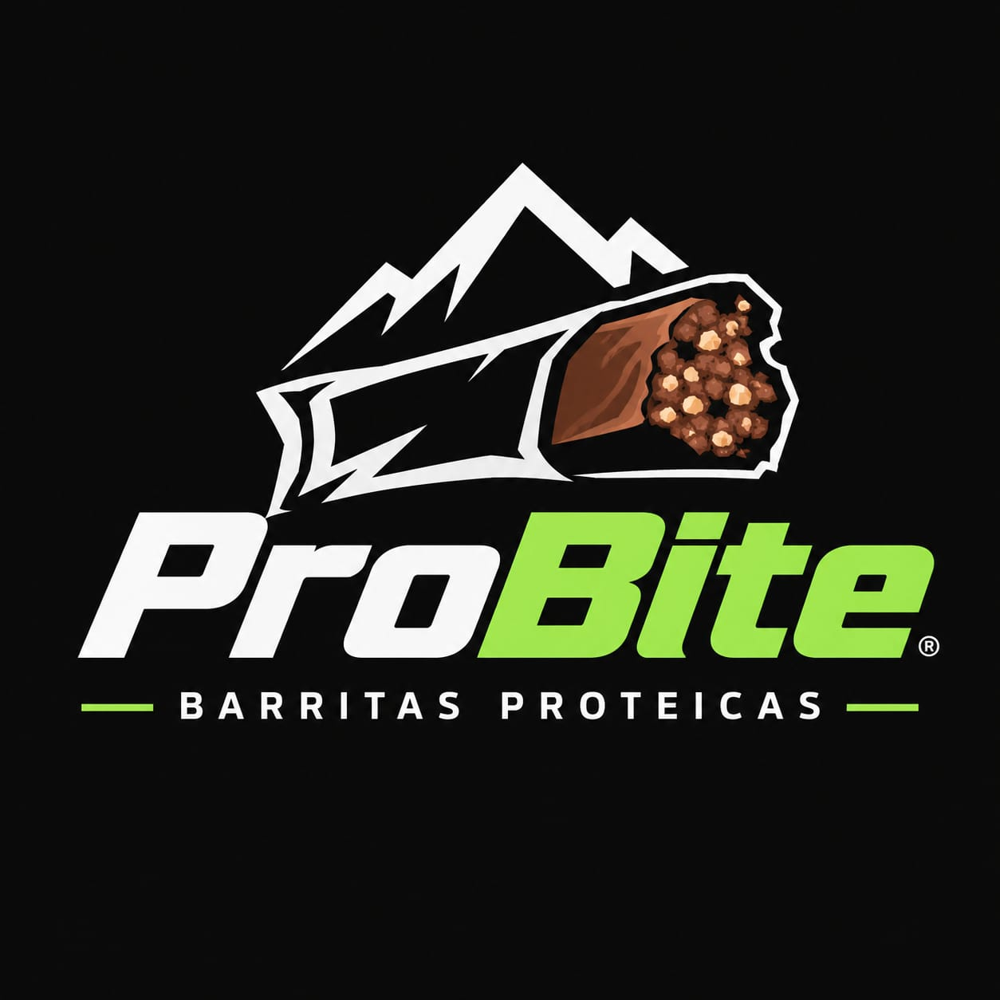

<p align="center">
  
</p>

# ProBite: sitio web

Landing page de **ProBite**, una barra de proteína de almendra, cacahuate, amaranto y arándano con miel, pensada para personas de 18 a 40 años que entrenan y hacen deporte.

El sitio es una sola página estática en HTML y CSS, sin build ni dependencias de JavaScript.

## Estructura

```
.
├── index.html          # Landing completo (HTML + CSS en un solo archivo)
├── logo-probite.png    # Logo (también se usa como favicon y og:image)
└── README.md
```

> Las carpetas `.claude/` y `spect/` (contexto del producto y del comprador) están excluidas del repositorio en `.gitignore`.

## Secciones

1. **Hero:** "Entrena. Muerde. Sube.", con la barra ilustrada, el precio y los datos clave.
2. **Beneficios:** práctica, buen sabor, proteína y energía, sin jarabes ni conservadores.
3. **Ingredientes:** gramos por barra de cada ingrediente, con ilustraciones propias en SVG.
4. **Nutrición:** tabla nutrimental por barra y por 100 g, y sellos NOM-051 explicados.
5. **Para quién es:** los cuatro perfiles del buyer persona.
6. **Dónde comprar:** 7-Eleven, OXXO, Walmart, Garis, Amazon y Mercado Libre.
7. **Footer:** contacto y redes sociales.

## Diseño

| Elemento | Valor |
|---|---|
| Fondo | `#0A0A0A` (fondo del logo) |
| Verde lima | `#A1E64F` ("Bite" del logo) |
| Café | `#783F2B` (interior de la barra) |
| Durazno | `#FFD2A1` (chispas de cacahuate) |
| Titulares | [Archivo](https://fonts.google.com/specimen/Archivo), itálica ancha y pesada |
| Texto | [Figtree](https://fonts.google.com/specimen/Figtree) |

Las fuentes se cargan desde Google Fonts. El sitio es responsive y respeta `prefers-reduced-motion`.

## Ejecutar en local

Abre `index.html` en el navegador, o levanta un servidor estático:

```bash
python3 -m http.server 8000
# http://localhost:8000
```

## Pendientes antes de publicar

- [ ] Reemplazar los `href="#"` de los botones "Cómpralo aquí" por las URLs reales de cada tienda y marketplace.
- [ ] Reemplazar los `href="#"` de Facebook, Instagram y TikTok cuando existan las cuentas (hay un comentario en el HTML que lo indica).
- [ ] Confirmar los valores nutrimentales con un análisis bromatológico en laboratorio certificado. Hoy son valores de referencia.
- [ ] Revisar el contenido legal (sellos NOM-051, claims y aviso de privacidad) antes del lanzamiento.
- [ ] Agregar fotos reales del producto cuando estén disponibles; hoy se usan ilustraciones.

## Contacto

[hola@probite.com](mailto:hola@probite.com)

---

© 2026 ProBite. Todos los derechos reservados.
